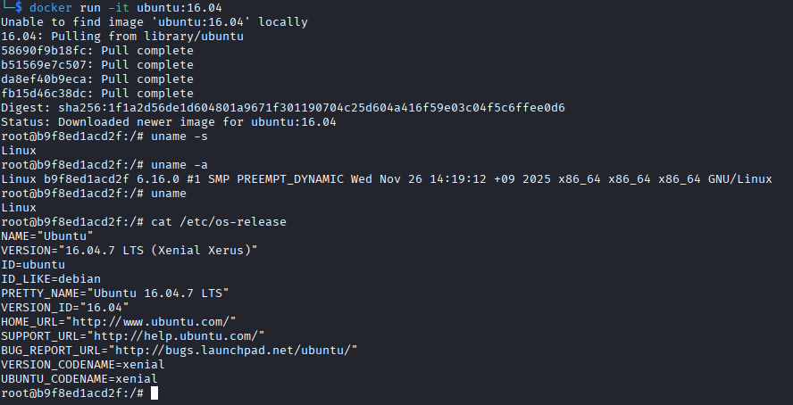
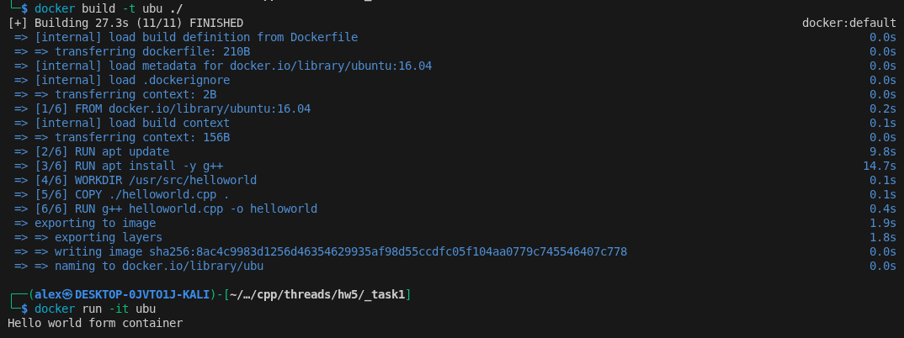
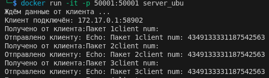
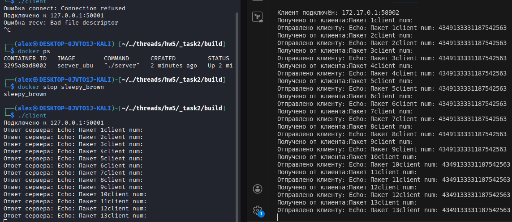

## Task 1

[helloworld.cpp](./_task1/helloworld.cpp)

[Dockerfile](./_task1/Dockerfile)

## Task 2

[Dockerfile](./_task2/Dockerfile)

[server](./_task2/server.cpp)

[CMakeLists server](./_task2/CMakeLists_serv.txt)

[client](./_task2/client.cpp)

[CMakeLists](./_task2/CMakeLists.txt)

